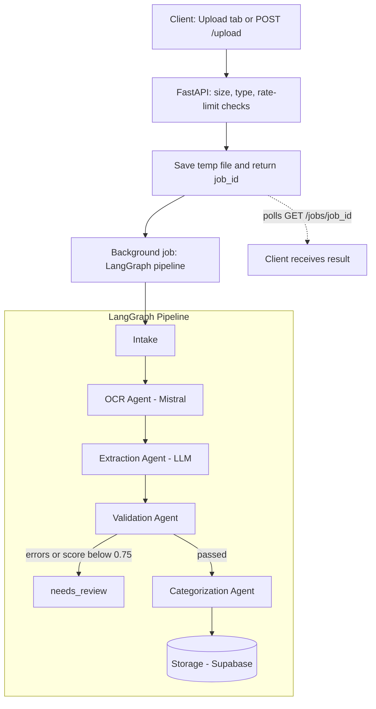
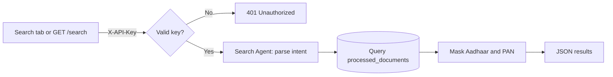

# DocuFlow

**A multi-agent document automation pipeline with a web UI and HTTP API.**

DocuFlow turns unstructured invoices, receipts, and KYC documents into validated, searchable, structured records. Upload a PDF or image and the system runs OCR, LLM-based extraction, rule-based validation, categorization, and storage automatically. Low-confidence results are routed to human review instead of being stored.

[Live Demo](https://docuflow-gbh3.onrender.com) | [API Docs (Swagger)](https://docuflow-gbh3.onrender.com/docs) | [Full Documentation](docs/DOCUMENTATION.md)

---

## Why DocuFlow

Manually copying vendor names, invoice totals, or Aadhaar/PAN details from PDFs is slow and error-prone. DocuFlow automates the whole flow:

```
ingest -> extract -> validate -> route -> store
```

## Key Features

- **Multi-agent pipeline** orchestrated with LangGraph (OCR, extraction, validation, categorization, storage)
- **Three document types:** invoices, receipts, and KYC (Aadhaar, PAN, Passport)
- **Configurable LLM provider:** Gemini, OpenAI, or Anthropic
- **Confidence scoring** with a human-review gate (`needs_review`)
- **Async jobs:** upload returns a `job_id` immediately; clients poll for the result
- **Identity search** with natural-language queries and masked Aadhaar/PAN in responses
- **Upload safeguards:** file size limit, file-type check, and per-IP rate limiting

## Architecture

### Upload pipeline



### Search flow



### Components

| Component | Responsibility |
|---|---|
| **OCR Agent** | Reads text from PDFs and images using Mistral OCR |
| **Extraction Agent** | Converts OCR text into structured JSON matching the Pydantic schema, with one automatic repair retry |
| **Validation Agent** | Checks required fields, dates, invoice totals, and ID formats; produces a confidence score |
| **Categorization Agent** | Assigns a category (Travel, Office Supplies, Software, Identity Verification, etc.) |
| **Search Agent** | Parses search intent and queries stored records |
| **Storage** | Persists documents and processed records in Supabase (Postgres + JSONB) |
| **FastAPI + Static UI** | Upload and Search tabs, job polling, and API authentication |

## Tech Stack

| Layer | Technology |
|---|---|
| Language | Python 3.12+ |
| API and UI host | FastAPI, Uvicorn |
| Orchestration | LangGraph |
| Schemas | Pydantic v2 |
| OCR | Mistral OCR API |
| LLM | Gemini, OpenAI, or Anthropic |
| Database | Supabase (Postgres + JSONB) |
| Frontend | HTML, CSS, JavaScript |
| Deployment | Render |

## Run Locally

### Prerequisites

- Python 3.12+
- A Supabase project
- API keys for Mistral (OCR) and one LLM provider

### Steps

**1. Clone the repository**

```bash
git clone https://github.com/Ayush-2308/DocuFlow.git
cd DocuFlow/docuflow
```

**2. Create and activate a virtual environment**

```bash
python -m venv .venv
.venv\Scripts\activate           # Windows
# source .venv/bin/activate      # macOS / Linux
```

**3. Install dependencies**

```bash
pip install -r requirements.txt
```

**4. Configure environment variables**

```bash
copy .env.example .env           # Windows
# cp .env.example .env           # macOS / Linux
```

Fill in your keys in `.env`. See [Environment Variables](#environment-variables).

**5. Set up the database**

Run `db/migrations.sql` once in the Supabase SQL editor.

**6. Start the server** (from the `docuflow/` directory)

```bash
uvicorn main:app --reload --host 127.0.0.1 --port 8000
```

**7. Open the app**

- UI: http://127.0.0.1:8000
- Swagger docs: http://127.0.0.1:8000/docs

## Environment Variables

| Variable | Description |
|---|---|
| `SUPABASE_URL` | Supabase project URL |
| `SUPABASE_KEY` | Supabase server key |
| `OCR_API_KEY` | Mistral API key |
| `OCR_ENDPOINT` | `https://api.mistral.ai/v1/ocr` |
| `OCR_PROVIDER` | `mistral` |
| `LLM_API_KEY` | LLM provider API key |
| `LLM_PROVIDER` | `gemini`, `openai`, or `anthropic` |
| `SEARCH_API_KEY` | Secret used for search (the UI Password field) |

Never commit your `.env` file.

## Testing

```bash
cd docuflow
python -m unittest discover -s tests -v
```

## Documentation

For the API reference, data schemas, agent details, deployment on Render, security notes, and known limitations, see [docs/DOCUMENTATION.md](docs/DOCUMENTATION.md).

## Author

**Ayush**
GitHub: [@Ayush-2308](https://github.com/Ayush-2308)
